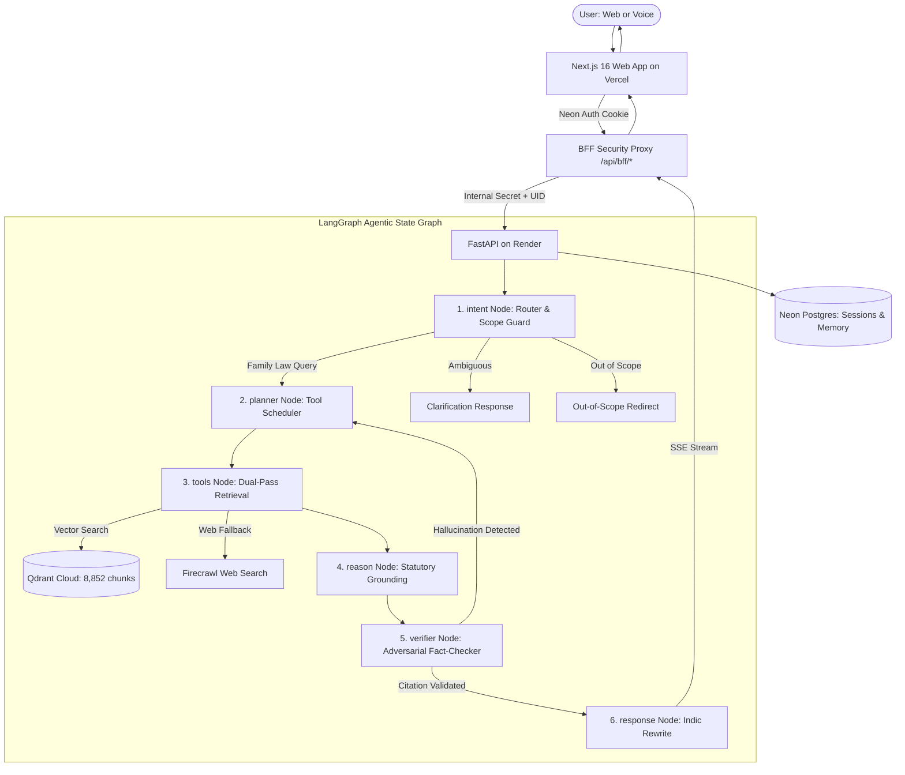

# Law Saathi (लॉ साथी / ಲಾ ಸಾಥಿ)

**Multilingual Agentic AI Legal Assistant for Indian Family Law — Grounded in Bare Statutory Acts across English, Hindi, and Kannada.**

[](https://law-saathi.vercel.app)
[](https://github.com/Kamal-Nayan-Kumar/law_saathi)
[-4F46E5?style=for-the-badge)](#academic-project-details)
[](https://fastapi.tiangolo.com)
[](https://nextjs.org)
[](https://langchain-ai.github.io/langgraph/)

---

## Academic Project Details

- **Student Developer:** Kamal Nayan Kumar
- **Roll Number:** 23bds026
- **Course:** Large Language Models (LLM)
- **Course Instructor:** Dr. Krishnendu Ghosh
- **Project Title:** Law Saathi: Trustworthy Multilingual Legal Assistance for Indian Family Law via Agentic RAG and Statutory Verification

---

## Executive Summary

Family law disputes in India (marriage, divorce, custody, maintenance, domestic violence, and succession) are fraught with emotional distress and obscured by archaic colonial legalese. Standard commercial LLMs frequently hallucinate legal sections, mix up personal laws (Hindu, Muslim, Christian, Special Marriage), or invent citations.

**Law Saathi** solves this through a multi-agent **LangGraph** architecture that:
1. **Never gives unverified legal advice** — Grounds every response strictly in ~8,852 indexed statutory passages from 11 central family Acts.
2. **Adversarially Verifies Claims** — Uses a dedicated Verifier agent that rejects answers with unsupported citations (tested at 100% precision on mutation tests).
3. **Pioneers Multilingual Legal Retrieval** — Dual-pass retrieval (Native Indic + English pivot) combined with native rewriting (not literal translation) in Hindi and Kannada.
4. **Transparent Step-Level Streaming** — Citizen observes intermediate reasoning steps ("How Saathi worked this out") in real time via Server-Sent Events (SSE).

---

## Live Deployed Links

| Service | Host | Status | Link |
|---|---|---|---|
| **Web Application** | Vercel (Next.js 16 + React 19) | Production | [law-saathi.vercel.app](https://law-saathi.vercel.app) |
| **Backend API** | Render (Docker / FastAPI) | Production | Routed securely via Next.js BFF proxy (`/api/bff/*`) |
| **Vector Database** | Qdrant Cloud | Active | 8,852 vectors (`intfloat/multilingual-e5-small`) |

---

## The Three Evaluation Pillars

### 1. Implementation (Live System Showcase)
- **Production Web Application:** Responsive Next.js 16 interface with authenticated chat, speech-to-text (Sarvam AI), and speech synthesis.
- **Secure Authentication:** Neon Auth (Better Auth) with HTTP-only cookies and BFF proxy pattern protecting the private FastAPI backend.
- **Interactive Multi-Turn Chat:** Supports complex family law queries, conversational memory, follow-ups, and adaptive clarification.
- **Boundary Guardrails:** Detects and politely redirects out-of-scope non-family legal queries (criminal, property, taxation).

### 2. Knowledge (Agentic AI Architecture & SLM Strategy)
- **6-Node LangGraph State Machine:**
  - `intent`: Classifies user input into legal Q&A, follow-up, clarification, greeting, or out-of-scope.
  - `planner`: Dynamically selects tools (Qdrant vector search vs Firecrawl live web fallback for Supreme Court case law).
  - `tools`: Executes hybrid dual-pass vector search with multilingual query pivoting.
  - `reason`: Formulates statutory grounded explanation based strictly on retrieved chunks.
  - `verifier`: Adversarial agent verifying bare act section alignment, presence of legal disclaimer, and absence of hallucinated penal codes.
  - `response`: Multilingual rewrite in native idiom (English, Hindi, Kannada).
- **API Today vs Small Language Model (SLM) Fine-Tuning Roadmap:**
  - *Current Production:* Groq LPU API (`openai/gpt-oss-120b`) for low-latency 500+ tok/s inference without datacenter GPU overhead.
  - *Future Work:* Domain adaptation and fine-tuning of an open SLM (Llama-3-8B / Qwen-2.5-7B) using QLoRA / PEFT on the **Vaquill / Open Law India** dataset (`vaquill/open-india-law` from Hugging Face) for offline, privacy-first edge execution.

### 3. Analysis (Rigorous Evaluation & Benchmarking)
- **Live Golden Evaluation Suite (23 test cases):**
  - Overall Pass Rate: **14 / 23 (60.9%)**
  - English: **11 / 18 (61.1%)**
  - Hindi: **2 / 3 (66.7%)**
  - Kannada: **1 / 2 (50.0%)**
- **Adversarial Verifier Stress Testing:**
  - **20 / 20 Mutations Caught (100% Precision)** — Zero false passes when hallucinated sections were introduced.
- **LLM-as-a-Judge Evaluation (RAGAS Criteria):**
  - Faithfulness: **4.0 / 5.0**
  - Statutory Citation: **3.75 / 5.0**
  - Tone & Explanatory Clarity: **4.75 / 5.0**
  - Language Appropriateness: **5.0 / 5.0**
  - Out-of-Scope Refusal Accuracy: **5.0 / 5.0**
- **Retrieval Honesty:**
  - Raw top-3 vector search scored only **2 / 8 (25%)**, proving why an agentic planner + multi-step reasoning is essential over naive RAG.

---

## System Architecture



---

## Datasets & Ingestion Pipeline

| Dataset | Source | Usage |
|---|---|---|
| `vaquill/open-india-law` | [Hugging Face](https://huggingface.co/datasets/vaquill/open-india-law) | Central family legislation (Hindu Marriage Act 1955, CrPC 125, PWDVA 2005, etc.) |
| `corpus/amendments.jsonl` | Hand-Curated | Editorial amendment notices for HMA §13B and SMA §28 mutual consent divorce cooling periods |
| `golden_qas.py` | Benchmark Set | 23 gold-standard family law queries across English, Hindi, and Kannada |

---

## Local Setup & Quickstart

### Prerequisites
- Python 3.9+
- Node.js 18+
- Neon Postgres instance
- Qdrant Cloud cluster
- Groq API Key

### 1. Clone Repository
```bash
git clone https://github.com/Kamal-Nayan-Kumar/law_saathi.git
cd law_saathi
```

### 2. Backend Setup
```bash
python3 -m venv .venv
source .venv/bin/activate
pip install -r api/requirements.txt
cp .env.example api/.env
# Run locally with SQLite
DATABASE_URL="sqlite:///./lawsathi.db" uvicorn app.main:app --app-dir api --reload --port 8000
```

### 3. Frontend Setup
```bash
cd web
npm install
cp ../.env.example .env.local
npm run dev
# Open http://localhost:3000
```

### 4. Run Test Suite
```bash
# Backend unit & integration tests (54+ passing tests)
.venv/bin/python -m pytest api/tests -q

# Frontend build & type check
cd web && npm run build
```

---

## License

This project is licensed under the MIT License. Developed for academic submission in the **Large Language Models (LLM)** course under **Dr. Krishnendu Ghosh** by **Kamal Nayan Kumar (23bds026)**.