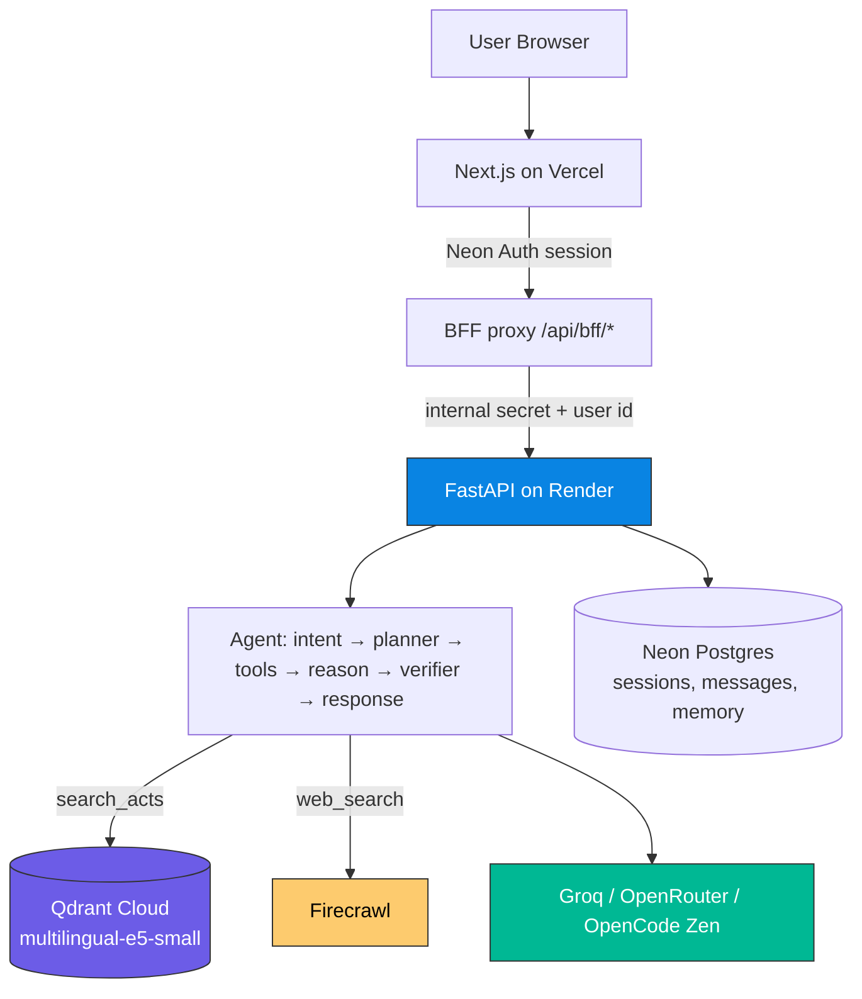
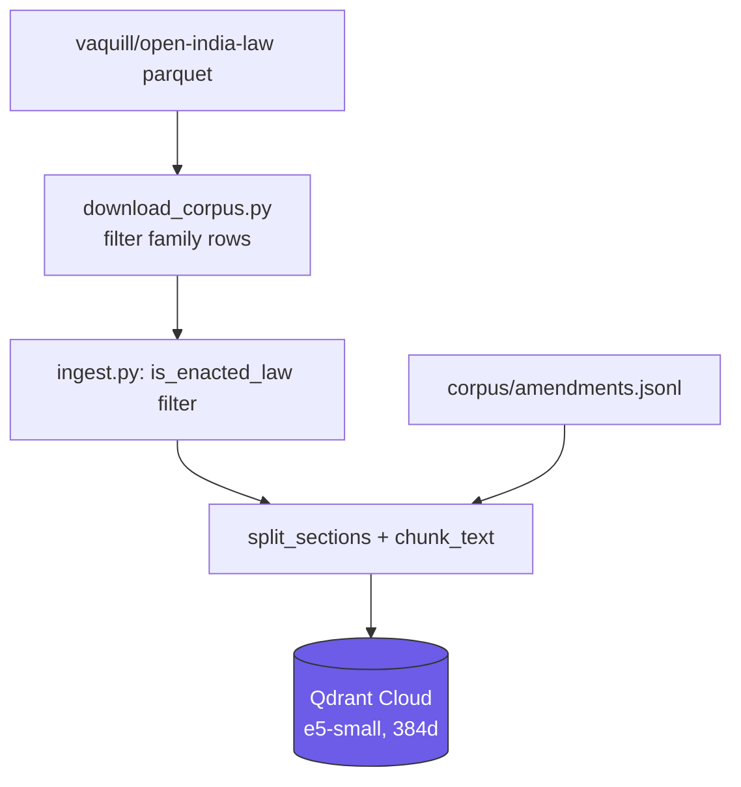

# Law Saathi

**Multilingual agentic AI legal support for Indian family law — ask in English, Hindi, or Kannada, get grounded answers from the bare Acts, in your language.**

---

## What is Law Saathi?

Law Saathi is a multilingual, AI-powered legal support system for Indian family law.
It helps people understand family law — marriage, divorce, custody, maintenance,
adoption, succession, and domestic violence — through text or voice, in the
language they use.

It does not give legal advice. It reads the bare Acts, checks every claim against
them, and explains the result in plain words.

---

## Live deployed link

| Portal | Link |
|---|---|
| Web app | [law-saathi.vercel.app](https://law-saathi.vercel.app) |
| API (FastAPI) | Render service `law_saathi` — see `render.yaml` |

The API has no stable public hostname; its address lives in the Vercel production
env as `FASTAPI_URL`. The browser never talks to the API directly — Next.js
verifies the Neon Auth session and proxies every request.

---

## What it does

- **Ask a question** in English, Hindi, or Kannada (or Hinglish) — get an answer
  in the same language, grounded in the bare Acts, with citations.
- **Follow-up questions** are resolved against the conversation history, so
  "how long does it take?" after a divorce question is answered correctly.
- **Voice input and read-aloud** in all three languages.
- **Source transparency** — every answer shows which Act and section it rests on,
  and which claims were checked against the passages.
- **Out-of-scope guard** — questions outside family law get a short redirect
  instead of a fabricated answer.

---

## Datasets

| Source | Link | What we take from it |
|---|---|---|
| `vaquill/open-india-law` (gated, HF token) | https://huggingface.co/datasets/vaquill/open-india-law | Only `in_central_legislation.parquet`, streamed (never the full ~54 GB dump). Enacted central family-law acts and in-force provisions. |
| `corpus/amendments.jsonl` (hand-curated) | this repo | Two editorial `kind: amendment_notice` chunks for SMA s.28 and HMA s.13B. Central Acts still publish pre-2018 text for mutual-consent divorce, so these notices alert retrieval. |

India Code is not ingested raw — its URLs and act handles are referenced in chunk
metadata as citations of record.

The live Qdrant collection `law_saathi` holds ~8,852 points: 11 family Acts
(Hindu Marriage 1955, Special Marriage 1954, Hindu Adoption & Maintenance 1956,
Hindu Succession 1956, Guardians & Wards 1890, Domestic Violence 2005, Indian
Divorce 1869, Indian Christian Marriage 1872, Parsi Marriage & Divorce 1936,
Foreign Marriage 1969, Family Courts 1984, Parents & Senior Citizens 2007) plus
wider civil/criminal material tagged by topic.

The golden eval set (`api/eval/golden_qas.py`) was seeded from
`steamed-potatop/indian-family-law-data` and rewritten to assert a governing
section. It is never ingested into Qdrant.

---

## Features

- **Agentic pipeline** — intent → planner → tools → reason → verifier →
  response, with a bounded verifier retry loop and Firecrawl web-search fallback.
- **English pivot + native rewrite** — non-English questions are pivoted to
  English for retrieval, then the verified answer is rewritten (not translated)
  into the reader's language.
- **Verifier** — every claim is checked against the retrieved passages before
  the answer ships.
- **Streaming** — step-level SSE progress, then the verified answer streams in.
- **Voice** — Sarvam STT (`saaras:v4`) and browser speech synthesis.
- **Memory** — session history + long-term memory, without carrying a stale
  topic into an unrelated question.
- **Admin upload** — ingest your own documents into a scoped collection.

---

## Tech stack

| Layer | Choice |
|---|---|
| Frontend | Next.js 16 (App Router) + React 19 + TypeScript |
| Backend | FastAPI (Python 3.9) |
| Agent | LangGraph (with inline fallback runner) |
| LLM | Groq `openai/gpt-oss-120b` (fallbacks: `gpt-oss-20b`, `qwen3.8-27b`), OpenRouter, OpenCode Zen last resort |
| Vector DB | Qdrant Cloud (`intfloat/multilingual-e5-small`, 384-dim, server-side embeddings) |
| Web search | Firecrawl |
| Auth | Neon Auth (Better Auth) |
| Database | Neon Postgres |
| STT | Sarvam `saaras:v4` (fallback `whisper-large-v3-turbo`) |
| Deploy | Vercel (web) + Render (API, Docker) |

---

## Architecture



### Ingestion



---

## Setup

**Prereqs:** Python 3.9+, Node 18+, a Neon Postgres database, a Qdrant Cloud
cluster, Groq API key, Firecrawl API key, Neon Auth project.

```sh
# 1. Clone
git clone https://github.com/Kamal-Nayan-Kumar/law_saathi.git
cd law_saathi

# 2. Backend
python3 -m venv .venv
.venv/bin/pip install -r api/requirements.txt
cp .env.example api/.env   # fill DATABASE_URL, INTERNAL_API_SECRET, GROQ_API_KEY, etc.
# Run with SQLite locally (no Neon needed):
DATABASE_URL="sqlite:///./lawsathi.db" .venv/bin/uvicorn app.main:app --app-dir api --reload
# → http://localhost:8000

# 3. Frontend
cd web
npm install
cp ../.env.example .env.local   # set NEON_AUTH_BASE_URL, NEON_AUTH_COOKIE_SECRET,
                                # INTERNAL_API_SECRET (same value), FASTAPI_URL=http://localhost:8000
npm run dev
# → http://localhost:3000

# 4. Ingest family-law corpus (optional, needs Qdrant + HF token)
.venv/bin/python api/scripts/ingest_family_law.py
```

### Tests

```sh
.venv/bin/python -m pytest api/tests -q        # 54+ tests, no live keys needed
cd web && npm run build                        # TypeScript + static generation
```

### Env

- `api/.env`: `DATABASE_URL`, `INTERNAL_API_SECRET` (same value as web),
  `GROQ_API_KEY`, `QDRANT_URL`, `QDRANT_API_KEY`, `FIRECRAWL_API_KEY`,
  `NEON_AUTH_BASE_URL`.
- `web/.env.local`: `NEON_AUTH_BASE_URL`, `NEON_AUTH_COOKIE_SECRET`,
  `INTERNAL_API_SECRET`, `FASTAPI_URL`.

See `.env.example` for the full list.