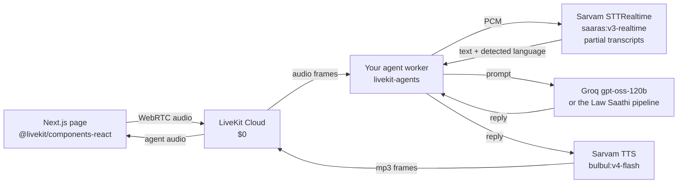

# Professor review, October 2026

What was tested, what was found, what was changed, and what I would do next.

---

## 1. How it was tested

| Method | What it covered |
|---|---|
| 36-question battery through the real API, live Qdrant, live Groq | English, Hindi, Kannada, Hinglish. Plain questions, typos, emotional phrasings, one-word questions, out-of-scope questions, questions that name a personal law. |
| Browser run with ego-browser on the local app | The actual page a user sees: the composer, the Thinking panel, the sources, the read-aloud button, the language of the interface. |
| A/B on the live Groq API with the real rewrite prompt | 11 runs per configuration, to measure the native-rewrite failure rate rather than guess at it. |
| The full test suite, before and after every change | 415 tests, 414 pass and 1 skipped (a live-network smoke test). |

Every number below comes from one of those four.

---

## 2. The six defects that matter

### 2.1 The native rewrite failed about one time in three, and an English answer shipped to a Hindi reader

**What the reader got.** "मेरे पति ने 6 महीने से मासगी नहीं दी" produced an answer that was entirely in English, with the disclaimer in Hindi. The Thinking panel said so: "सरल भाषा में उत्तर लिखा (अंग्रेज़ी में ही रखा — हिंदी में फिर लिखना असफल रहा)". That line is inside a collapsed panel, so the reader never saw it.

**Why.** `gpt-oss-120b` spends most of its token budget reasoning before it answers. `MAX_TOKENS_LONG` is 1,800 (`api/app/agent.py:62`). The reasoning took about 5,500 tokens, the budget ran out, and Groq returned an **empty content field**. `chat_complete` reads an empty content field as "this model did not answer", tries the next model, and eventually gives up. The English draft then ships as it is.

**Measured, on the live API, with the real rewrite prompt:**

| Configuration | Empty replies | Mean completion tokens | Time per call |
|---|---|---|---|
| as it was (`max_tokens=1800`, no `reasoning_effort`) | 4 of 11 | 1,688 | ~4.4 s |
| `reasoning_effort: "low"` | 0 of 11 | 231 | ~1.0 s |

**What was changed.** `reasoning_effort: "low"` is now sent for the gpt-oss models (`api/app/agent.py`, `_model_extra`). The reasoning drops from about 5,500 tokens to about 140, the answer fits, and the call is 4x faster.

**Why this is also a rate-limit fix.** Groq's free tier meters 8,000 tokens a minute. One call at 1,688 tokens is five calls a minute; at 231 it is thirty-five. The old behaviour spent the whole quota thinking about a 200-word answer. That is why the app so often fell through to the template, and it is why the circuit breaker kept taking Groq out.

**Also fixed.** A completion with `finish_reason: "length"` is now treated as a failed call, so an answer cut mid-word is never shipped. Two were shipping: one ended "…नज़रअंदाज़ किय", the other "…ನಿಮ್ನ ನಿರ್ದಿಷ್ಟ", and the second was marked *verified*, because the verifier only checks that the claims are supported by the passages, not that the sentence finishes.

### 2.2 Valid family-law questions were refused as "out of scope"

Three real refusals, each with a different cause:

| Question | What it got | Why |
|---|---|---|
| `my husbend hasnt paid maintenence for 6 months what can i do` | "I'm a family-law assistant, so I can only help with marriage, divorce, custody…" | The topic is found by exact substring. "maintenence" and "husbend" are not in the list, no topic was found, and the default for "no topic" was *out of scope*. |
| `मैं अपने पति के खिलाफ शिकायत दर्ज करना चाहती हूं` | The same redirect, in Hindi | "complaint" is an out-of-scope keyword. The Hindi family word list had neither "पति" nor "शिकायत", so nothing outweighed it. |
| `ನನ್ನ ಹಿಂದಿನವರು ನನ್ನಿಂದ ಸಂಪತ್ತು ಕೋಲಿಕೆ ಮಾಡುತ್ತಿದ್ದಾರೆ` | The same redirect, in Kannada | The English pivot came back as "demanding **property**", and the scope check ran only on the pivot. |

**What was changed.**

- **Typo tolerance.** When the exact match finds nothing, a word within one or two edits of a keyword counts (`_near_miss`, `_edit_distance_at_most`). "husbend", "maintenence", "custodyy", "adopton", "divors" now route correctly. It only runs when nothing matched, so it cannot change an answer that already worked.
- **The scope check now reads the reader's own words.** The question is refused only when the native text *and* the English pivot both look out of scope. A pivot that widens "dowry" into "property" can no longer refuse a dowry question.
- **Two tiers of out-of-scope.** A domain we never cover (land, tax, police, bank, employment, passport, contract) wins even when a family member is named. A soft word (rent, notice, complaint, police) does not, because those words turn up in real family-law questions.
- **"A complaint about a family member" is a domestic-violence question**, not an unknown topic.
- The everyday words are in now: "मासगी", "पति", "पत्नी", "मामा", "बेटा", "हिरासत", "शिकायत", "ಹಣಕಾಸು", "ಕೋಲಿಕೆ", "ಮಕುವಿನ ಆಧಿಕಾರ", "ಹೆಣ್ಣೆಯ ಮದುಪೆ", "ಹಿಂದಿನವರು".

### 2.3 The corpus was already tagged for this, and the tags were not being used

Every chunk in the index carries a `topic` tag, and those tags line up with the agent's own topics. A bare vector search ignores them:

| Question | Bare search returned | With the topic filter |
|---|---|---|
| "minimum age for a girl to get married" | Surrogacy (Regulation) Act, 2021 | **Prohibition of Child Marriage Act, 2006** |
| "my husband beats me" | Divorce Act, 1869 | **Protection of Women from Domestic Violence Act, 2005** |
| "custody of my 3-year-old" | Special Marriage Act, 1954 | **Hindu Minority and Guardianship Act, 1956 s.6** (custody under five) and Guardians and Wards Act, 1890 s.17 |
| "my in-laws are demanding dowry" | PWDV Act | **Dowry Prohibition Act, 1961 s.3** (the prohibition of demand) |

**What was changed.** A second search scoped to the topic tag, run alongside the unfiltered one so a wrongly detected topic loses nothing. Its hits are also put back at the top *after* the Act ranking, because the planner's choice of Act was pushing them back down. That ranking is the one thing the topic filter has to overrule, or "the minimum age to marry" comes back as Hindu Marriage Act s.18 (the penalty for a child marriage) instead of the age itself.

### 2.4 Three word lists disagreed with each other

There were three separate lists of family words: `TOPIC_KEYWORDS` (used for routing), the list inside `is_oos` (used for the scope check), and `PARTY_WORDS` (used for "who is asking"). They did not agree.

- **"मासगी"**, the ordinary Hindi word for maintenance, was in none of the topic lists. The commit `bc5848a` added "मेहनाना" and "महनाना" but not the word people actually type. A Hindi maintenance question only worked because the English pivot came back.
- **"दहेज" and "ಕೋಲಿಕೆ"** (dowry) were in the scope list but not the topic list, so a dowry question in Hindi or Kannada matched no topic at all.
- **"हिरासत"** (custody) was missing, so "तलाक के बाद बच्चे की हिरासत किसे मिलती है" was classified as a *divorce* question, and a divorce question has to ask which personal law applies. The reader got a religion question instead of an answer about the child.
- **"ಮದುಪೆ" and "ಹೆಣ್ಣೆಯ ಮದುಪೆ"** were missing, so the Kannada marriage-age question matched no topic.

They are now one list, plus one scope list with a documented difference.

### 2.5 The app knew the answer was in the wrong language, and said so only in a collapsed panel

`node_response` already tracked whether the native rewrite worked, and the Thinking panel already said "kept in English — rewriting it in Hindi failed". Two things were missing:

- **The client was never told.** `AskOut.lang` returned the language of the *question*, not the language of the *answer*, so "Read aloud" read an English answer with a Hindi voice. The API now reports the language the answer is actually in, and the assistant message row stores it.
- **The clarifying question came back in English to a Hindi reader.** The template was already Hindi, and the code then handed it to the model with "Translate it once", so the model translated the Hindi back into English: "For proper guidance — what was your marriage according to which religion or custom…". The template is used as it is now.

### 2.6 The corpus is not what the README says, and it is lopsided for the audience this is for

The README says the live collection holds "about 8,852 points: 11 family Acts … plus wider civil/criminal material tagged by topic". The live index holds **2,367 points across 37 acts**. The README is wrong, and `AGENTS.md` still describes 1,823 Code of Civil Procedure chunks that are no longer there.

More important than the number is the shape:

| Topic tag | Chunks | Dominant Act |
|---|---|---|
| succession | 582 | **Indian Succession Act, 1925 (517)** — the Christian/Anglo-Indian act |
| marriage | 392 | Indian Christian Marriage Act, 1872 (121) |
| children | 342 | Juvenile Justice Act, 2015 (219) |
| divorce | 203 | Divorce Act, 1869 (106) |
| maintenance | 119 | spread across four acts |
| domestic_violence | 58 | PWDV Act, 2005 |
| **Hindu Succession Act, 1956** | **65** | the act most Indian families actually need |

A quarter of the index is one succession act, and for the people this project is for it is the wrong one. The personal-law filter rescues the routing, but the ranking has to fight the pile every time.

**Also:** the Firecrawl key is out of credit. Web search returns nothing at all, and it fails at INFO level, so it looks like it never ran. `EVALUATION_REPORT.md` quotes answers with web-sourced Supreme Court citations. Those are not reproducible today.

---

## 3. Before and after, same 36 questions

| | Before | After |
|---|---|---|
| Non-English answers written in the reader's script | 17 of 22 | **22 of 22** |
| Valid questions refused as out of scope | 3 | **0** |
| A clarifying question instead of an answer | 9 | **2** |
| Answers cut off mid-word | 2 | **0** |
| Answers with no citation at all | 9 | **4**, all of them deliberate (2 out-of-scope refusals, 2 succession clarifications) |
| Time to an answer | 13–30 s | 11 s median, 14 s worst |

The two remaining clarifications are both succession questions ("my father died without a will, how is the land divided" and the Kannada version of it). The law genuinely differs between a Hindu and a Muslim family, and `SCOPE.md` says the system should ask rather than guess. That is a defensible choice, but it is a choice, and section 5.6 has the alternative.

---

## 4. LiveKit: yes, and it is free

**Short answer: a realtime voice agent in English, Hindi and Kannada costs nothing for a student demo, and LiveKit has an official Sarvam plugin, so there is no custom plugin to write.**

| Piece | Choice | Cost |
|---|---|---|
| Media | LiveKit Cloud, Build plan | $0, no card. 5,000 WebRTC participant-minutes a month, 100 concurrent. |
| Agent framework | `livekit-agents` (Python, Apache-2.0) | $0, self-host on your laptop |
| Speech to text | `sarvam.STTRealtime` (official plugin) | Sarvam gives ₹100 signup credit, about ₹17 for a 10-minute demo |
| Language model | Groq `openai/gpt-oss-120b` | $0, the key is already in this repo |
| Speech out | `sarvam.TTS`, `bulbul:v4-flash` | Same ₹100 credit. 224 voices, including `chaitra_kn_conversation` and `aayan_hi_conversational`. |

**The shape:**



**The interesting part for this project.** The agent worker does not have to be a plain LLM call. `api/app/agent.py` is already a five-node pipeline with retrieval, a verifier and a native rewrite. Wrapping *that* as the LiveKit agent's LLM step means the voice agent answers from the bare Acts, cites sections, and speaks in the reader's language, with the same guarantees the text chat has. The retrieval and the rewrite are the project; the voice is the interface.

**Roughly 2 to 4 hours of work:**

```bash
# 1. keys
#    cloud.livekit.io   -> LIVEKIT_URL, LIVEKIT_API_KEY, LIVEKIT_API_SECRET
#    dashboard.sarvam.ai -> SARVAM_API_KEY
brew install livekit-cli && lk cloud auth

# 2. the agent worker
uv init law-voice && cd law-voice
uv add "livekit-agents[sarvam,groq]~=1.8" python-dotenv

# 3. the frontend
npm i @livekit/components-react livekit-client livekit-server-sdk
```

```python
from livekit import agents
from livekit.agents import Agent, AgentServer, AgentSession, TurnHandlingOptions
from livekit.plugins import sarvam, groq

class LawSaathi(Agent):
    def __init__(self, lang: str = "en-IN") -> None:
        super().__init__(
            instructions="You give Indian family-law information in the user's "
                         "own language. Plain words, name the section you rely on. "
                         "No markdown, no emoji, no legal advice.",
            stt=sarvam.STTRealtime(language="auto", stream_type="fast"),
            llm=groq.LLM(model="openai/gpt-oss-120b",
                         base_url="https://api.groq.com/openai/v1"),
            tts=sarvam.TTS(target_language_code=lang, model="bulbul:v4-flash",
                           speaker="shubh_en_narration_gentle"),
        )

server = AgentServer()

@server.rtc_session(agent_name="law-saathi")
async def saathi(ctx: agents.JobContext):
    session = AgentSession(
        turn_handling=TurnHandlingOptions(turn_detection="stt",
                                          endpointing={"min_delay": 0.07}),
    )
    await session.start(agent=LawSaathi(), room=ctx.room)
    await session.generate_reply(instructions="Greet the user in their language.")

if __name__ == "__main__":
    agents.cli.run_app(server)
```

**Things that will bite, so they do not have to be found the hard way:**

- The Build plan is a **hard cap**, not a soft one. Past 5,000 minutes, requests fail.
- Run the agent **on your own laptop**, not deployed to LiveKit Cloud. The deployed agent has a 10 to 20 second cold start, which is fatal in a live demo.
- **Do not use Groq Whisper for speech to text.** It has no streaming endpoint, so the agent has to buffer and upload a file. Sarvam's realtime endpoint has partial transcripts and its own voice activity detection.
- `turn_detection="stt"` uses Sarvam's own voice activity detection and never touches LiveKit's turn detector, so it does not eat the free allowance.
- One `sarvam.TTS` instance is one language. To switch with the reader, either run one agent per language, or write one small router class that picks the instance by the script of the text. That is about 40 lines.
- Expect 1.0 to 1.6 seconds between the user stopping and the agent speaking. That is good enough for a demo.

**What is already in this repo that makes it cheaper:** the server-side text-to-speech route added in this branch (`POST /voice/speak`, Sarvam Bulbul, verified working for English, Hindi and Kannada). That is the same Sarvam account and the same model the LiveKit plugin uses, so the voice work is shared.

---

## 5. What I would do next, in this order

### 5.1 Rebalance the corpus, and fix the README

- Downweight or drop the Indian Succession Act, 1925. 517 chunks of the Christian act, in a product for Indian families, is a retrieval bias waiting to happen.
- Add the acts `AGENTS.md` already lists as missing: Muslim Family Laws Act 1963, Muslim (Guardianship and Maintenance) Act 1926, Muslim Inheritance (Succession to Property) Act 1926. The Muslim maintenance question currently has one route through BNSS s.144, and the corpus does not hold the Muslim family law Acts at all.
- Add the Child Marriage Act, 1929 explicitly. The Prohibition of Child Marriage Act, 2006 is in the index and it is what the topic filter now finds, which is a better answer than the bare Act of 1929 because it is in force and in the corpus.
- Correct the README's "8,852 points, 11 family Acts" to the real 2,367 and 37, and correct `AGENTS.md`'s Code of Civil Procedure line.

### 5.2 Make the eval measure the outcome, not the mechanism

The golden set is 18 English questions and 5 non-English ones. The 415 tests all passed while an English answer was shipping to Hindi readers, so the suite is measuring the plumbing.

- Put the same question in all three languages, and add the typo and Hinglish variants. Assert the *script of the answer*, not that a rewrite was attempted.
- Add a golden question for every defect in section 2, so each one has a test that fails if it comes back.
- Add a live language-fidelity check to the nightly run: ask 20 questions in three languages, and report the share that came back in the reader's script. That is the one number the professor's claim rests on, and it should be a number rather than an impression.

### 5.3 Stop depending on one free tier

OpenRouter is out of credit (402) and OpenCode Zen answers 400. Groq is the only provider that answers, on an 8,000 token a minute free allowance. A second Groq key, or a $5 paid tier, removes the single point of failure. The `reasoning_effort` change already made this about seven times less likely.

### 5.4 Decide about web search

Either top up Firecrawl (free credits exist) or remove the claim. Right now `EVALUATION_REPORT.md` describes answers that cannot be reproduced.

### 5.5 Build the LiveKit voice agent

Two to four hours, as in section 4. The pipeline behind it already exists.

### 5.6 Three things this audience needs that the product does not have

- **Where to go, not just "see a lawyer".** Every answer ends with "consult a lawyer", and never says where. For the people this is for, the single most useful line is the free one: the **District Legal Services Authority** gives free legal help, and a **Lok Adalat** can settle a family dispute without a trial. That is one sentence, in three languages, and it turns a dead end into a next step.
- **The state.** The app says "we do not know your state" and stops. Procedure varies by state, and a maintenance filing is a state-level thing. Asking "which state are you in" once, and storing it, is cheap and makes the next steps real.
- **A voice-first path for the people who cannot read.** The answer, the "read aloud" button, the next steps and the disclaimer are all there. The interface itself is text. A single large "ask by voice" screen, where the whole answer is read out and the next step is one spoken reply, is a different product for an elderly or low-literacy user, and it is the one the project brief is really describing.

---

## 6. Files changed in this branch

| File | What changed |
|---|---|
| `api/app/agent.py` | `reasoning_effort` for the reasoning models; `finish_reason == "length"` treated as a failure; the answer's language reported; typo tolerance in topic detection; the topic detection reading the reader's own words; the scope check on the native text as well as the pivot; two tiers of out-of-scope; the everyday Hindi and Kannada words; the topic-scoped retrieval search; the local clarifying template used without a model |
| `api/app/routers_chat.py` | `POST /voice/speak`; the assistant message and `AskOut.lang` report the language of the answer |
| `api/app/schemas.py` | `SpeakIn`, `SpeakOut` |
| `api/app/voice.py` | `synthesize` rewritten for the current Sarvam Bulbul API, with a speaker per language |
| `web/lib/voice.ts` | The voice is picked by language, not merely requested; the server speaks when the device has no voice for the language; the "what to do next" list is cut in every language |
| `api/tests/test_agent.py` | Two tests clear the global provider breaker; the live smoke test skips when no provider answers instead of failing |
| `scripts/prof_review_probe.py` | The 36-question probe, kept so this can be re-run |
| `scripts/rewrite_ab.py`, `scripts/rewrite_probe.py` | The A/B that measured the rewrite failure |
