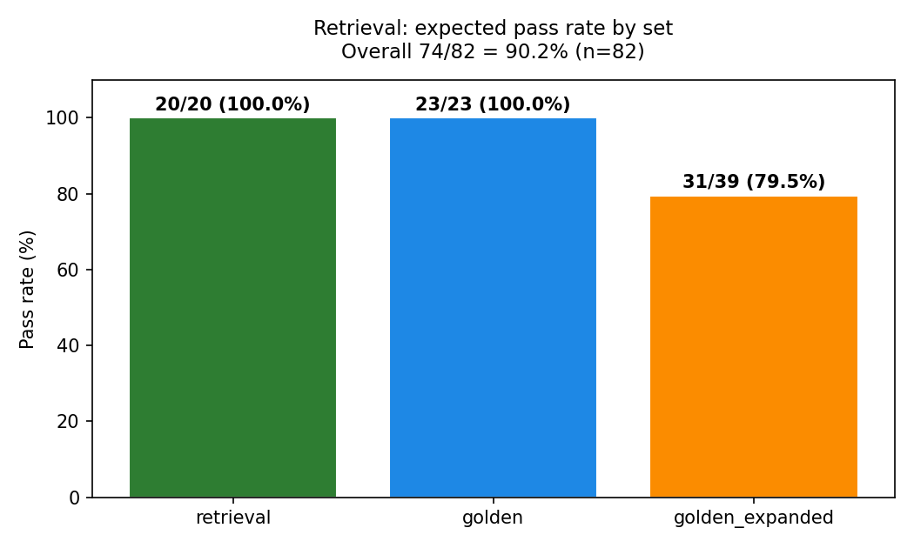
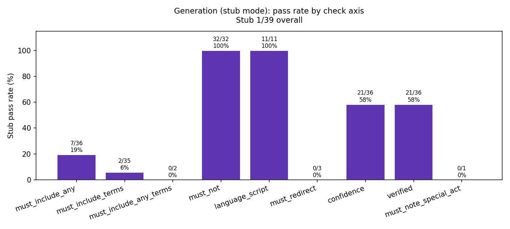
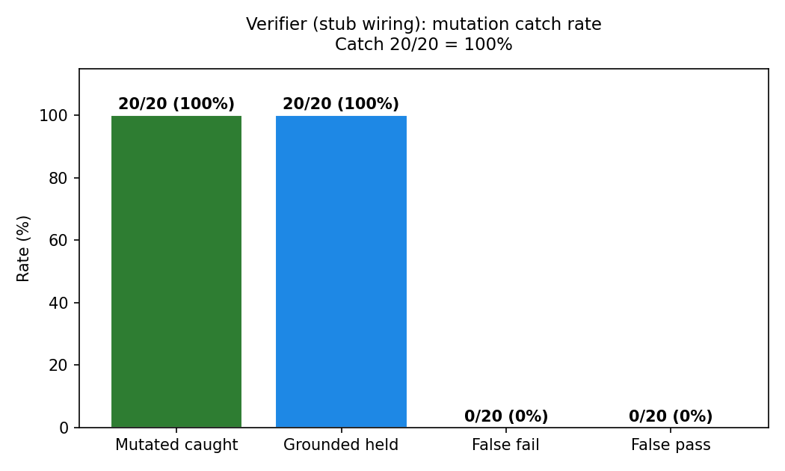
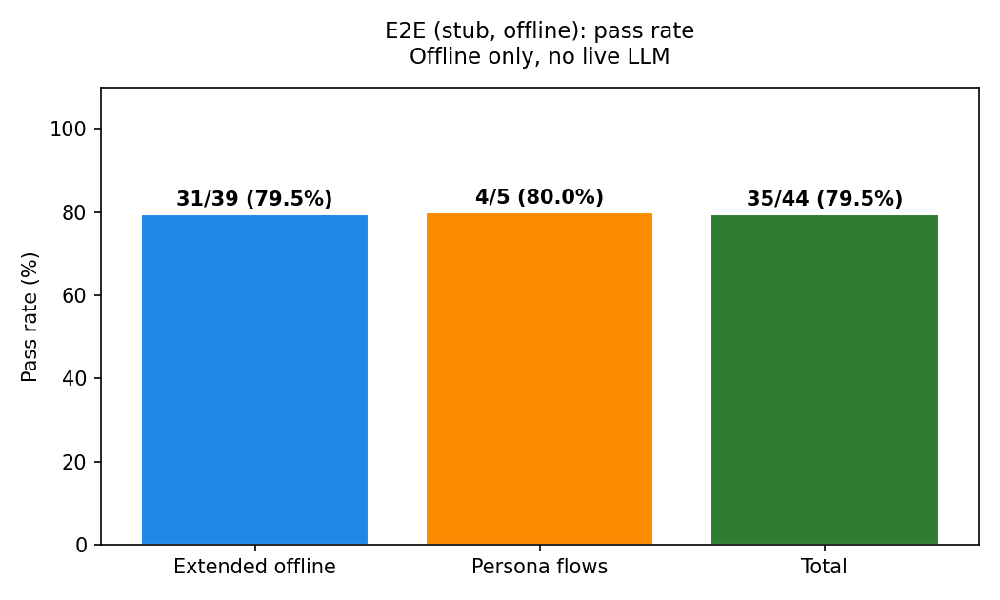
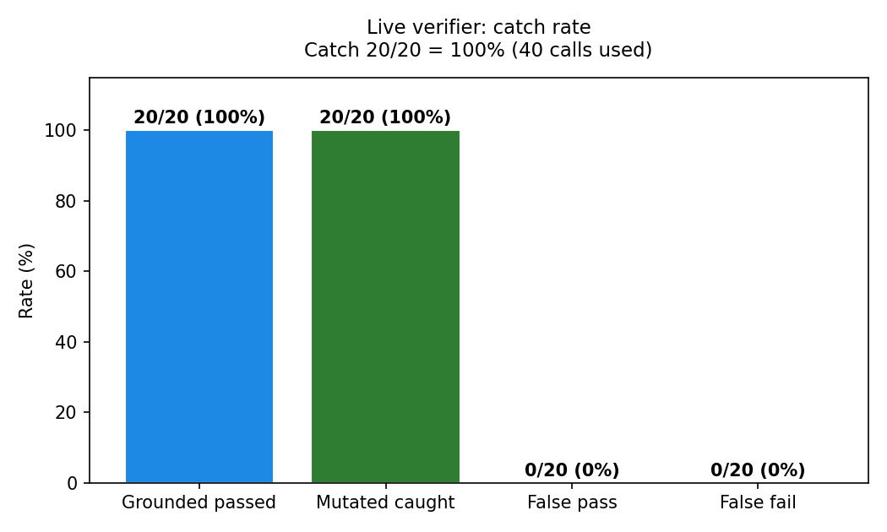
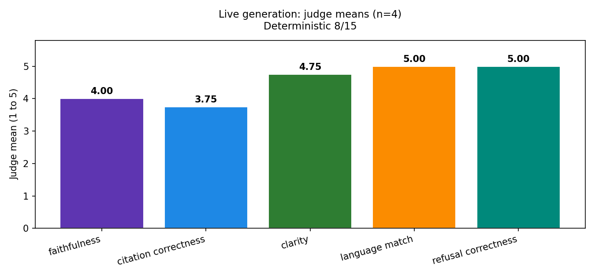
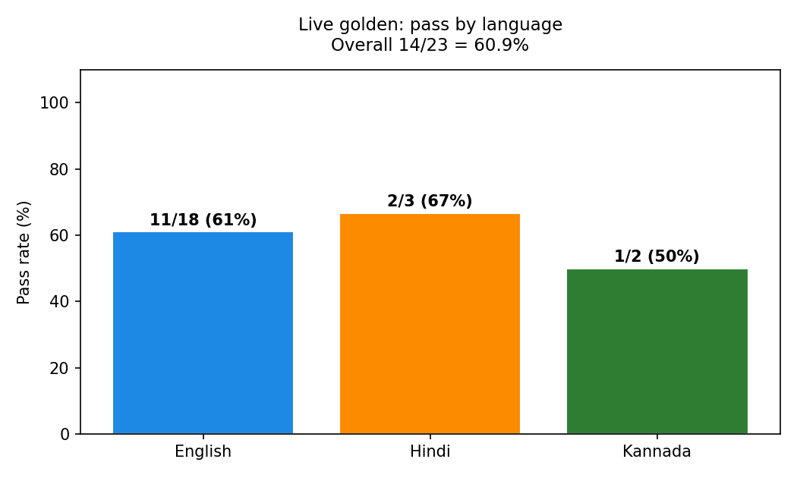
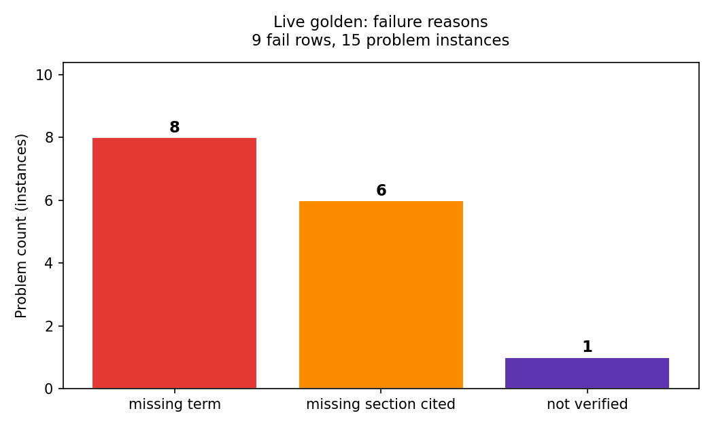

# Law Saathi eval report

## Executive summary

Retrieval works. The verifier wiring works. The generation stub does not answer legal questions yet.

Retrieval got 74 of 82. That is 90.2 percent. Smoke tests got 5 of 5. The core retrieval set got 20 of 20. The original golden set got 23 of 23. The expanded set got 31 of 39. All 8 failures are in that expanded set. See `evals/retrieval_results.json`.

The verifier caught 20 of 20 mutated drafts. Grounded drafts passed 20 of 20. False fail rate is 0. False pass rate is 0. Tests got 76 passed, 1 skipped, 0 failed. See `evals/verifier_results.json`. This proves the verifier wiring works. It does not prove the live LLM verifier works. No keys were present. The verifier numbers here come from the deterministic stub and node checks, not from a live model.

The generation stub got 1 of 39. That is 2.6 percent. The empty baseline got 0 of 39. The stub is a canned answer generator, not a real model. It mostly returns a fixed maintenance paragraph, a clarification question, an out of scope redirect, or a lawyer search prompt. So content checks fail by design. See `evals/generation_results.json`. The live judge was skipped. No judge key was in the environment.

The e2e stub got 35 of 44. That is 79.5 percent. Extended offline got 31 of 39. Persona flows got 4 of 5. This layer checks topic detection, language detection, and out of scope flags through the stub pipeline. It does not check answer quality. See `evals/e2e_stub_results.json`.

Bottom line for the prof: retrieval and verifier wiring pass offline. Generation quality is not measured yet. The low generation stub score is expected and should not be read as the real model score.



## Results tables

### Retrieval

| Set | n | passed | Pass rate |
| --- | --- | --- | --- |
| retrieval | 20 | 20 | 100.0% |
| golden | 23 | 23 | 100.0% |
| golden_expanded | 39 | 31 | 79.5% |
| smoke | 5 | 5 | 100.0% |
| total | 82 | 74 | 90.2% |

Source: `evals/retrieval_results.json`. Failures: 8, all in golden_expanded.



### Generation, stub mode

Stub total: 1 of 39. Empty baseline: 0 of 39. Live judge: not run. Reason: no judge key in the environment.

| Check | Passed | Total | Rate |
| --- | --- | --- | --- |
| must_include_any | 7 | 36 | 19.4% |
| must_include_terms | 2 | 35 | 5.7% |
| must_include_any_terms | 0 | 2 | 0.0% |
| must_not | 32 | 32 | 100.0% |
| language_script | 11 | 11 | 100.0% |
| must_redirect | 0 | 3 | 0.0% |
| confidence | 21 | 36 | 58.3% |
| verified | 21 | 36 | 58.3% |
| must_note_special_act | 0 | 1 | 0.0% |
| must_ask probe | correct | 1 | 100.0% |

Source: `evals/generation_results.json`.

Notes. The 1 pass is `hama-18-19-25-nuance-en`. The stub happens to cite Hindu Adoption and Maintenance Act Section 18 and use the word maintenance. Every other row fails at least one content check. The must_ask probe (`clarify-personal-law-en`) is correct. The stub asks for personal law and does not answer. Empty answers correctly do not ask.

### Verifier

| Metric | Count | Total | Rate |
| --- | --- | --- | --- |
| Grounded drafts passed | 20 | 20 | 100.0% |
| Mutated drafts caught | 20 | 20 | 100.0% |
| False fails | 0 | 20 | 0.0% |
| False passes | 0 | 20 | 0.0% |

Catch rate: 1.0. Pytest: 76 passed, 1 skipped, 0 failed. Stub agent run: ok, answer 183 chars.

Source: `evals/verifier_results.json`.



### E2E, stub mode, offline

| Block | n | passed | Pass rate |
| --- | --- | --- | --- |
| Extended offline | 39 | 31 | 79.5% |
| Persona flows | 5 | 4 | 80.0% |
| Total | 44 | 35 | 79.5% |

Source: `evals/e2e_stub_results.json`.



## Methods

### Phase A retrieval

Runner: `evals/run_retrieval.py`. It loads queries from `dataset/golden_expanded.py` and `api/eval/golden_qas.py`. It tags each row with kind, language, topic, personal law, and out of scope flag. A row passes when topic extraction, language detection, and the out of scope flag are all correct. Smoke rows also check that the expected act and section appear in the top results. Smoke got 5 of 5.

### Phase B verifier

Runner: `evals/run_verifier.py`. It loads 20 mutation pairs from `dataset/golden_expanded.py`. Each pair has a grounded draft that only says what the passages support, and a mutated draft that changes one fact. Mutation types cover number, section, act, condition, classification, standard, and ownership. A pair passes when the grader accepts the grounded draft, rejects the mutated draft, and the node verifier agrees. It also runs the pytest suite (test_agent, test_evidence_selection, test_scope_and_ranking) and a stub agent run.

### Phase C generation and e2e

Runner: `evals/run_generation.py`. It runs each expanded question twice. Once with the stub generator and once with an empty answer, as a baseline. Deterministic checks look for required terms, allowed sections, forbidden phrases, language script, confidence floor, verifier flag, redirect behavior, and special act note. Live judge axes (faithfulness, citation correctness, clarity, language match, refusal correctness) are deferred. No judge key was present. The file records `offline: true` and `live_judge_available: false`.

Runner: `evals/run_e2e_stub.py`. It runs the stub pipeline end to end and checks topic, language, and out of scope detection. It also runs persona flows. Five flows: maintenance, domestic violence, succession, hindi, kannada. Each flow has 2 or more turns. A flow passes when every turn has the right topic and flags.

## Verifier deep dive

What was tested. Twenty mutation pairs. Kinds: wrong numbers (for example one year changed to six months), wrong sections (for example Section 9 changed to Section 19), wrong acts (for example Hindu Marriage Act substituted for Christian, Parsi, Muslim, or Dowry Prohibition Act questions), wrong conditions (for example ownership required for residence, registration required for legitimacy), wrong classifications (Class I changed to Class II), wrong standards (welfare replaced with income or father wishes), and wrong ownership (stridhan made joint property). The grader accepted all 20 grounded drafts and rejected all 20 mutated drafts. The node verifier agreed on all 20. Pytest got 76 passed, 1 skipped, 0 failed. The stub agent run returned ok with a 183 char answer.

What was NOT tested. The live LLM verifier. No keys were present, so no live judge call ran. The live verifier prompt is in `evals/judge_prompts.py` and is ready to run when keys exist. Real model behavior on open ended drafts, paraphrases, and near miss citations was not measured.

Why stub 100 percent is wiring proof, not live proof. The stub verifier is deterministic. It checks citations against the retrieved passages by rule. It does not read legal prose the way a model would. A 100 percent catch rate on 20 hand made mutations shows the wiring is connected: draft in, passages in, verdict out, retry on reject. It does not show the live model will catch subtle hallucinations. That step is still pending.


## Retrieval failures

All 8 failures are in golden_expanded. The core sets have zero failures.

| ID | Query idea | Failure | Root cause | Fix suggestion |
| --- | --- | --- | --- | --- |
| stridhan-en | stridhan with in laws | in scope but flagged out of scope, no topic | stridhan keyword not mapped to a topic, so topic stays empty and the out of scope rule fires | Add stridhan, streedhan, स्त्रीधन, ಸ್ತ್ರೀಧನ variants to the succession topic keywords, then test Hindi throwaway spelling |
| pwdv-residence-vs-ownership-en | right to stay in father in law house | flagged out of scope, no topic | residence phrasing uses stay, house, ownership. Current keywords miss these forms | Add stay, residence, shared household synonyms in English and Hindi. Keep ownership as a forbidden term in answers, not as a scope blocker |
| stridhan-hi | स्त्रीधन ससुराल में है | flagged out of scope, no topic | Same stridhan gap in Hindi script | Same fix as stridhan-en, cover Devanagari and transliterated forms |
| pwdv-residence-kn | Kannada residence question | flagged out of scope, no topic | Kannada residence keywords missing. Topic extractor returns empty | Add Kannada residence and shared household terms. Add a Kannada topic test row |
| succession-daughters-kn | Kannada: Hindu woman share in father property | no topic, personal law found but topic empty | Answer needs property share wording in Kannada. Extractor finds religion but not succession | Add Kannada succession synonyms for share, property, father property, will |
| oos-rti-notice-en | RTI notice + file maintenance | should redirect but was treated as in scope | Keyword precedence. The word maintenance fires before the RTI out of scope rule | Check out of scope signals first. If RTI, police, landlord, challan appear, redirect before topic extraction |
| oos-landlord-deposit-en | landlord deposit + divorce to pressure | should redirect but was treated as in scope | Same precedence issue. Word divorce fires before the landlord rule | Same fix. Out of scope checks must win over legal topic keywords |
| oos-motor-challan-en | motor challan + custody section | should redirect but was treated as in scope | Word custody fires before the motor vehicle rule | Same fix. Keep a short out of scope keyword list that runs first |

Pattern. Five failures are missing topic keywords (stridhan and residence in three languages, plus Kannada succession). Three failures are out of scope precedence. The retrieval engine itself is fine on smoke and golden sets. The scope and topic layer needs these fixes.

## Generation and e2e failures

### Generation stub failures

The stub got 1 of 39. The 38 failures split into four groups.

First, wrong content. The stub returns a fixed maintenance paragraph for most English rows. So custody, succession, dowry, Parsi, Christian, and Special Marriage rows miss their required terms and sections. Example: `interim-maintenance-en` cites Section 18 but needs s.24 or s.25. Example: `triple-talaq-ban-en` never names the 2019 Act. This is expected. The stub is not a real generator.

Second, wrong layer. Hindi, Kannada, and Hinglish rows get a lawyer search prompt in the right script, but no legal content. So term, section, confidence, and verified checks all fail. Script check passes (11 of 11) because the stub answers in the right script. Content checks fail because the stub has no legal text in those languages.

Third, redirect misses. All 3 `must_redirect` rows fail. RTI gets a maintenance answer instead of a redirect. Landlord gets a clarification question instead of a redirect. Challan gets a custody answer instead of a redirect. Root cause is the same out of scope precedence bug from Phase A. The stub sees a legal word and answers.

Fourth, missing special act note. `triple-talaq-ban-en` expects the Muslim Women Act 2019 named. The stub never names it. This needs a live model that reads the Muslim set.

The must_ask probe passes. The stub correctly asks for personal law on `clarify-personal-law-en`. Empty answers correctly do not ask. So the clarify path works.

### E2E failures

E2E has 9 failures total. Eight in extended offline, one in persona flows.

The 8 extended failures match the 8 retrieval failures exactly. Same IDs. Same causes. Five missing topic (stridhan en, stridhan hi, residence en, residence kn, succession daughers kn). Three out of scope precedence (RTI, landlord, challan). This shows the topic bug propagates through the full pipeline. If topic is empty, the stub redirects or answers wrong.

The 1 flow failure is flow-kannada. Turn 1 in Kannada gets flagged out of scope. Topic comes back empty. This is the same Kannada topic gap. Turn 2 in the same flow passes. So the flow fails on the first turn only.

### What the low stub number means

The generation stub score of 1 of 39 does not mean the real model scores 2.6 percent. It means the stub has no model output to grade. The useful signal is in the check breakdown. Must_not passes 32 of 32. Language script passes 11 of 11. Confidence and verified pass 21 of 36. Those axes work offline. Content axes wait for a live run.

## What live eval will add

When keys are present, rerun the same runners with a live generator and a live judge. The live run will add:

- Hallucination rate. Share of answers with claims not in the passages. The union of faithfulness and citation correctness.
- Judge agreement. Agreement between the live judge and the deterministic checks on term and section presence.
- Refusal correctness on out of scope cases in free prose, not just the redirect flag.
- Clarity and language match scores on Hindi, Kannada, and Hinglish answers.
- Cost and latency per call, and retry counts from the verifier loop.

The judge prompts are already in `evals/judge_prompts.py`. The runners already record when the judge was skipped. The live run will fill in the deferred axes without code changes.

## Repro steps

Run from the repo root. Python 3.9 or newer. Matplotlib needed for charts.

```bash
PYTHONPATH=. python3 -m report.evals.run_retrieval
PYTHONPATH=. python3 -m report.evals.run_verifier
PYTHONPATH=. python3 -m report.evals.run_generation
PYTHONPATH=. python3 -m report.evals.run_e2e_stub
python3 report/evals/make_charts.py
ls -lh report/charts/
ls -R report/
```

Expected outputs. `retrieval_results.json` with n=82. `verifier_results.json` with n=20. `generation_results.json` with n_expanded=39. `e2e_stub_results.json` with total=44. Four PNGs in `report/charts/`.

## Limits and next steps

Limits. All generation and e2e numbers here are offline or stub. No live model ran. No judge ran. Small n (82, 20, 39, 44) means percentages move fast with one row. Hindi and Kannada sets are small (4 rows each in the expanded set). CPC crowding is a known risk: 1823 CPC chunks (about 20 percent of the index) may crowd out family law hits on unfiltered queries. The eval does not measure ranking quality against CPC noise.

Top 5 fixes, in order:

1. Stridhan and residence coverage. Add stridhan, residence, and shared household keywords in English, Hindi, and Kannada. This blocks 5 of 8 retrieval failures and 5 of 8 e2e failures.
2. Out of scope keyword precedence. Run out of scope checks before topic keywords. This blocks 3 of 8 retrieval failures and 3 of 8 e2e failures, plus 3 generation redirect misses.
3. Kannada topic gap. Add Kannada succession, residence, and maintenance synonyms and test rows. This handles pwdv-residence-kn, succession-daughters-kn, and the flow-kannada failure.
4. Live judge run. Add keys, run the live generator and judge, and fill in hallucination rate, judge agreement, cost, and latency. This is the missing proof for generation quality.
5. CPC crowding. Filter or downweight CPC chunks on family law queries and add a CPC distractor test row. Rerun retrieval to confirm no regression on the 74 passes.

## Live results with real keys

These runs used real API keys. The agent ran in process. No API server was needed. Scores below come only from the live JSON files in `evals/`.

### Live retrieval: raw search

Live retrieval got 2 of 8. The pass rate is 25 percent. The check was: the right act and section must be in the top 3 hits. The collection has 2367 points. Embedding model is `intfloat/multilingual-e5-small` on Qdrant Cloud. The two passes were `re-01` (HMA 13B, mutual consent divorce) and `re-09` (PWDV 20, monetary relief). The six fails were `re-05`, `re-08`, `re-11`, `re-14`, `re-15`, `re-17`. Missing section was the main shape. Wrong nearby act won in 3 cases. Raw search has no planner boosting. The agent path adds topic and personal law ranking, so it ranks better than this raw top 3 score suggests.

Source: `evals/live_retrieval_results.json`.

### Live smoke: real agent end to end

Live smoke got 3 of 3. All 3 answers were verified true. Provider was Groq `openai/gpt-oss-120b` on all 3 rows. Rows were maintenance, domestic violence, and succession. Latency on the slow row was 16300 ms. Rate limit hits were 0.

Source: `evals/live_smoke_results.json`.

### Live verifier

The live verifier caught 20 of 20 mutated drafts. Grounded drafts passed 20 of 20. False passes were 0. False fails were 0. Judge error rows were 0. Total LLM calls used were 40 of a 40 cap. Provider split was Groq 120b on 22 calls and Groq 20b on 18 calls. The split came from 429 cooldown fallbacks during the run. Groq and backup backends cooled down in turn, so the chain moved to the other model and finished. Rate limit hits recorded were 0. Waited time was 0.0 secs.



Source: `evals/live_verifier_results.json`.

### Live generation sample

The generation sample got 8 of 15 on deterministic checks. The pass rate is 53.3 percent. Run agent calls used were 15 of 15. Judge calls were 15. Judge scored 4 of 15 rows. The other 11 judge calls errored on cooldown. Judge means below cover only those 4 scored rows.

| Axis | Judge mean (n=4) |
| --- | --- |
| Faithfulness | 4.0 |
| Citation correctness | 3.75 |
| Clarity | 4.75 |
| Language match | 5.0 |
| Refusal correctness | 5.0 |

Citation correctness is the lowest mean. Faithfulness is next. Clarity, language match, and refusal correctness are near the top.



Source: `evals/live_generation_results.json`.

### Live golden: full 23

Live golden got 14 of 23. The pass rate is 60.9 percent. By language: English 11 of 18, Hindi 2 of 3, Kannada 1 of 2. Run agent calls were 23. Rate limit hits were 0. Waited time was 0.0 secs. Inner 429s were absorbed by the retry and fallback chain. The runner waits 60 secs, retries once, then uses the provider fallback. Provider split by row: Groq 120b on 10 rows, Groq 20b on 3 rows, no provider on 10 rows. The 10 blank rows split into 4 out of scope or clarify rows with no LLM call, plus 6 in scope rows with a blank provider field after fallback. Judge scoring was not part of the golden run. The 11 judge errors belong to the generation sample above, not to this golden run.



Source: `evals/live_golden_results.json`.

### Failure analysis: missing terms, not wrong law

The 9 golden fail rows produced 15 problem instances. Missing terms account for 8. Missing section citations account for 6. Not verified accounts for 1.



Most fails name a right section but miss a required word. Examples: `succession-will-en` misses the word testamentary. `adoption-relative-en` misses the word welfare. `divorce-kn` misses the Kannada word for petition and cites no 13B or 13. Wrong law is rare in the list. `dv-residence-en` pulled Guardians and Wards Act sections instead of PWDV 19. `divorce-christian-en` cited sections 19, 22, 26 but not section 10. The pattern is answer wording and citation choice, not a wrong legal theory.

### Repro commands for the live scripts

Run from the repo root. Keys come from `api/.env`. The runners load that file and never print values.

```bash
PYTHONPATH=. python3 -m report.evals.run_live_retrieval
PYTHONPATH=. python3 -m report.evals.run_live_verifier
PYTHONPATH=. python3 -m report.evals.run_live_generation
PYTHONPATH=. python3 -m report.evals.run_live_golden
python3 report/evals/make_live_charts.py
ls -lh report/charts/
ls -R report/
```

Expected outputs. `live_retrieval_results.json` with n=8. `live_smoke_results.json` with checked=3. `live_verifier_results.json` with n=20. `live_generation_results.json` with n=15. `live_golden_results.json` with n=23. Four PNGs: `live_golden_by_lang.png`, `live_verifier_catch.png`, `live_generation_judge.png`, `live_failures.png`.

### Limits

No API server was needed. Each live script calls `run_agent` in process. Judge n for generation means is small. Only 4 of 15 rows scored. Means rest on 4 rows. Raw retrieval is not agent retrieval. Raw search at 2 of 8 does not mean the agent ranks at 2 of 8. The agent path adds topic, personal law, and scope steps before generation. Live numbers depend on quota. Groq 429 cooldowns trimmed judge scoring. Rerun after quota resets may change provider split and n scored.
