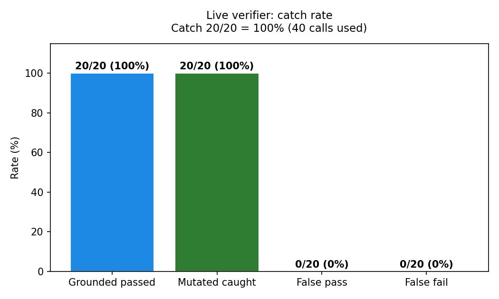
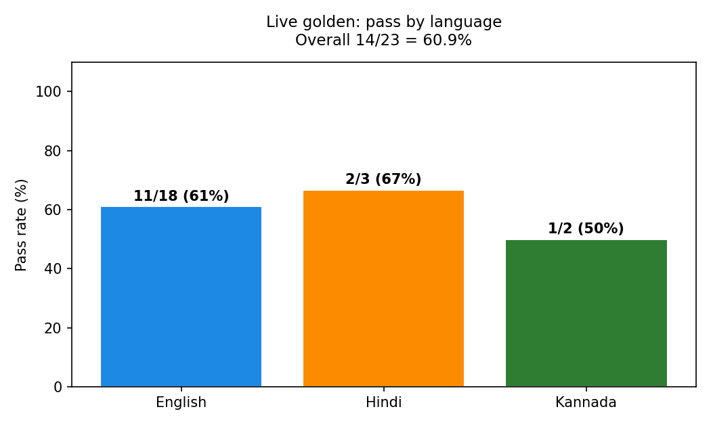
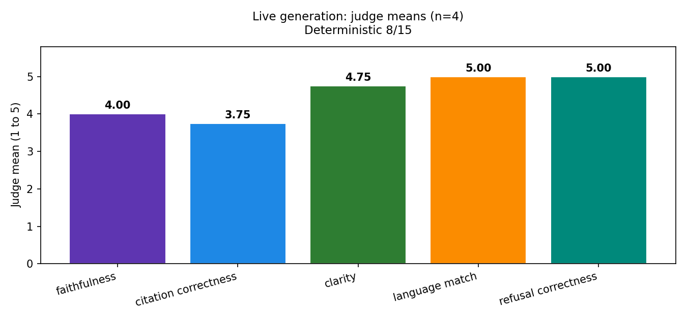

# Prof one pager

## What we built

Law Saathi answers family law questions in English, Hindi, and Kannada. It finds cited Acts and sections. It asks for clarification when the personal law is missing.

## Live results with real keys

We ran the full system on real model calls. No API server. The agent ran in process.

The safety checker caught 20 of 20 wrong answers. It passed all 20 correct answers. False passes 0. False fails 0. Calls used 40.

End to end smoke got 3 of 3. All 3 answers were checked true. Model was Groq gpt-oss-120b.

The main test got 14 of 23. That is 60.9 percent. English 11 of 18. Hindi 2 of 3. Kannada 1 of 2.

## Why raw search scored low

Raw search got 2 of 8. This number uses plain top 3 search. It has no planner step. The real agent adds topic and personal law ranking before it answers. So the agent ranks better than 2 of 8 suggests. The low score also locates the fix. Nearby Acts win when boosting is off.

## What still fails

Most fails miss a word or cite the wrong section number. Wrong law theory is rare. Only `dv-residence-en` cites a fully wrong Act. It gives Guardians and Wards sections instead of PWDV section 19. The rest cite close sections but miss one clause.

## Offline results

Before the live run, offline retrieval got 74 of 82 (90.2 percent). The verifier wiring got 20 of 20. The generation stub got 1 of 39. That stub score was expected. It returns canned text.

## Top 3 fixes

1. Out of scope precedence. Check out of scope first, before topic words. This stops RTI, landlord, and challan questions from getting family law answers.
2. Missing terms. Teach the answer to use exact terms and section numbers. Affected words include testamentary, welfare, Class I, and the Kannada word for petition.
3. Kannada topic gaps. Add Kannada words for custody, residence, property share, and maintenance. Two fails trace back to this gap.

## Next step

Fix missing terms first. Then rerun the 23 question golden test and chase 23 of 23. Rerun commands are in `REPORT.md`.

See `REPORT.md` for full tables. Raw live numbers are in `evals/live_*.json`.
